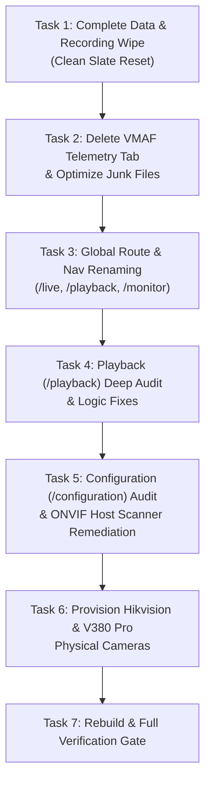

# QUANTIS VMS — SYSTEM CLEANUP, RESTRUCTURING & ONVIF REMEDIATION
## Autonomous Execution Briefing for DeepSeek v.4.1 Flash (1017)
**Target Platform:** Quantis AI Video Management System (Node.js 22 LTS, Vue 3.5, Express 5, MediaMTX, MySQL 8.4, Redis 7, PyAV/YOLOv8 CUDA)  
**Host Environment:** Windows 11 Host (`192.168.1.29`) with WSL2 (Ubuntu 24.04 LTS), NVIDIA RTX 4060 GPU  
**Execution Standard:** Zero regression, fail-closed security, atomic verification, and strict contract fidelity.

---

### REQUIRED SKILLS INVOCATION DIRECTIVE
Before touching any code or database, invoke and adhere to the guidelines of the following skills located in the global and repository agent skill paths:
- `systematic-debugging` / `debugging-and-error-recovery`: Isolate root causes using evidence; no blind guessing or trial-and-error.
- `incremental-implementation`: Execute changes in small, self-contained, verifiable slices.
- `mandatory-secure-web-skills`: Maintain strict AES-256-GCM credential encryption, parameterized queries, and input validation.
- `test-driven-development` / `tdd`: Update unit tests and run verification before declaring any task complete.
- `better-ui` / `antislop-ui`: Ensure frontend interface polish adheres to premium design tokens and responsive standards without AI slop.
- `api-and-interface-design`: Enforce strict JSON wire contract parity between API routes and frontend stores/views.
- `full-output-enforcement`: Provide complete, unabridged code changes—no placeholders, stubs, or `// TODO` comments.

---

## 1. ARCHITECTURE & SYSTEM OVERVIEW

Quantis VMS is a high-performance, GPU-accelerated video management system organized in a pnpm monorepo:
- `apps/web-dashboard`: Vue 3.5 + Vite + TypeScript frontend, served via Nginx on port `8080` (container `vms-web-dashboard`).
- `apps/api-server`: Express 5 + TypeScript REST/WebSocket API on port `3000` (container `vms-api-server`).
- `apps/api-server/src/transcode`: Transcode worker process (container `vms-transcode-worker`) utilizing NVENC and `libvmaf_cuda` for perceptual compression gating.
- `services/media-engine/recorder`: Zero-CPU fragmented MP4 RTSP stream recorder (container `vms-recorder`).
- `services/media-engine/rtsp-proxy`: Python RTSP proxy on port `8555` handling Digest authentication and SDP rewriting (container `vms-rtsp-proxy`).
- `services/media-engine/mediamtx.yml`: MediaMTX WebRTC/HLS/RTSP gateway (container `vms-mediamtx`).
- `services/ai-vision-worker`: YOLOv8/YOLO26n CUDA inference worker (container `vms-ai-vision-worker`).
- Persistence: MySQL 8.4 on port `3307` (`vms-mysql`), Redis 7 on port `6380` (`vms-redis`), and mounted volume `./data` (`/data/raw`, `/data/compressed`, `/data/tmp`, `/data/snapshots`).

---

## 2. DETAILED TASK SPECIFICATIONS



---

### TASK 1: COMPLETE DATA & RECORDING WIPE (CLEAN SLATE RESET)

**Objective:** Completely purge all video recordings, segments, activity windows, logs, test artifacts, and leftover camera data so Quantis behaves like a brand-new, freshly installed application that has never connected to any camera.

#### Step 1.1: Wipe Storage Directories on Disk
Purge all files inside the storage directories while preserving directory structure and `.gitkeep` markers:
```powershell
# From repo root: d:\anothervms
# Remove raw recordings
Get-ChildItem -Path data\raw -Exclude .gitkeep -Recurse | Remove-Item -Recurse -Force
# Remove compressed recordings
Get-ChildItem -Path data\compressed -Exclude .gitkeep -Recurse | Remove-Item -Recurse -Force
# Remove temporary files and test artifacts
Get-ChildItem -Path data\tmp -Exclude .gitkeep -Recurse | Remove-Item -Recurse -Force
# Remove snapshot files
Get-ChildItem -Path data\snapshots -Exclude .gitkeep -Recurse | Remove-Item -Recurse -Force
```
Ensure directory placeholders remain:
- `data/raw/.gitkeep`
- `data/compressed/.gitkeep`
- `data/tmp/.gitkeep`
- `data/snapshots/.gitkeep`

#### Step 1.2: Truncate Database Tables
Execute SQL commands against `vms_db` via the MySQL container to completely reset camera, recording, and event tables:
```bash
wsl bash -c "docker exec -i vms-mysql mysql -u vms_user -p<MYSQL_PASSWORD> vms_db << 'EOF'
SET FOREIGN_KEY_CHECKS = 0;
TRUNCATE TABLE ai_detection_events;
TRUNCATE TABLE recording_activity_windows;
TRUNCATE TABLE recording_chunks;
TRUNCATE TABLE vmaf_probe_logs;
TRUNCATE TABLE recordings;
TRUNCATE TABLE cameras;
SET FOREIGN_KEY_CHECKS = 1;
EOF"
```

#### Step 1.3: Flush Redis Cache
Clear stale camera URLs, BullMQ transcode jobs, rate limiters, and expired refresh tokens:
```bash
wsl bash -c "docker exec vms-redis redis-cli -a <REDIS_PASSWORD> FLUSHDB"
```

#### Step 1.4: Verify Admin Account Retention
Ensure the `users` table retains the `admin` account with valid hashed credentials:
```sql
SELECT id, username, role FROM users WHERE username = 'admin';
```
*(If table is empty, allow API server startup to seed admin: `admin` / `admin123` or your configured password).*

---

### TASK 2: ELIMINATE VMAF TELEMETRY TAB (`/vmaf`) & RECLAIM DISK SPACE

**Objective:** Completely remove the VMAF telemetry dashboard tab, its routes, navigation links, and associated dead assets, while preserving the backend's perceptual VMAF compression engine in `vms-transcode-worker`. Delete large legacy video fixtures to save disk space.

#### Step 2.1: Delete Frontend View Component
- Delete file: `apps/web-dashboard/src/views/VmafTelemetryView.vue`.

#### Step 2.2: Remove Route from Router
In `apps/web-dashboard/src/router/index.ts`:
- Remove `import VmafTelemetryView from "../views/VmafTelemetryView.vue";`
- Remove the child route definition:
  ```ts
  {
    path: "vmaf",
    name: "vmaf",
    component: VmafTelemetryView,
  },
  ```
- Add a 301/permanent redirect so any historical bookmarks to `/vmaf` redirect cleanly to `/live`:
  ```ts
  {
    path: "vmaf",
    redirect: "/live",
  },
  ```

#### Step 2.3: Remove VMAF Link from Sidebar Navigation
In `apps/web-dashboard/src/components/AppLayout.vue`:
- Remove the `<router-link :to="{ name: 'vmaf' }">...</router-link>` block (lines 28–36) containing the telemetry icon and label.

#### Step 2.4: Clean Up Locales
In `apps/web-dashboard/src/locales/en.json` and `apps/web-dashboard/src/locales/id.json`:
- Remove `"nav.vmafTelemetry"`.
- Remove all unused `"vmaf.*"` keys (e.g., `"vmaf.title"`, `"vmaf.queueStatus"`, `"vmaf.probeSteps"`, `"vmaf.cqCurve"`, etc.). Keep only general settings keys if referenced elsewhere.

#### Step 2.5: Purge Dead Heavy Files & Leftover Junk
Delete oversized test videos and orphaned scripts to reclaim substantial disk space:
- `tests/1minuteroad.mp4` (~156 MB) -> **DELETE**
- `tests/fixtures/fixture_hikvision_20s.mp4` (~20.3 MB) -> **DELETE**
- `tests/fixtures/fixture_20s.mp4` (~14.4 MB) -> **DELETE**
- `tests/fixtures/fixture_30s.mp4` (~21.4 MB) -> **DELETE**
- `tests/fixtures/hikvision_dist_cq32.mp4` (~11.5 MB) -> **DELETE**
- `scripts/capture-vmaf.mjs` -> **DELETE**
- `scripts/test-vmaf-api.mjs` -> **DELETE**

#### Step 2.6: Update Web Dashboard Unit Tests
In `apps/web-dashboard/src/stores.test.ts`:
- If tests in `stores.test.ts` reference `VmafTelemetryView` or old VMAF store methods, remove or adapt them so `pnpm test` passes with 100% green status.

---

### TASK 3: GLOBAL ROUTE & NAVIGATION RENAMING

**Objective:** Rename and restructure the three primary dashboard views according to modern VMS industry terminology:
1. **Camera Matrix** -> **Live View** (Route: `/live`, Route Name: `live`)
2. **Forensic Timeline** -> **Playback** (Route: `/playback`, Route Name: `playback`)
3. **Hardware Monitor** -> **System Monitor** (Route: `/monitor`, Route Name: `monitor`)

#### Step 3.1: Update Router (`apps/web-dashboard/src/router/index.ts`)
Update routes and add backward-compatible redirects:
```ts
children: [
  {
    path: "",
    redirect: "/live",
  },
  {
    path: "live",
    name: "live",
    component: LiveMatrixView,
  },
  {
    path: "matrix",
    redirect: "/live",
  },
  {
    path: "playback",
    name: "playback",
    component: TimelineView, // or PlaybackView
  },
  {
    path: "timeline",
    redirect: "/playback",
  },
  {
    path: "monitor",
    name: "monitor",
    component: HardwareMonitorView,
  },
  {
    path: "hardware",
    redirect: "/monitor",
  },
  {
    path: "configuration",
    name: "configuration",
    component: ConfigurationView,
  },
  {
    path: "settings",
    redirect: "/configuration",
  },
],
```
Update root 404 fallback:
```ts
{
  path: "/:pathMatch(.*)*",
  redirect: "/live",
}
```
Update navigation guards:
- `to.meta.guestOnly && token` -> `return next({ name: "live" });`

#### Step 3.2: Update Navigation Bar (`apps/web-dashboard/src/components/AppLayout.vue`)
- Brand link: `:to="{ name: 'live' }"`
- Nav item 1:
  - Route: `:to="{ name: 'live' }"`
  - Label: `{{ i18n.t('nav.liveView') }}`
- Nav item 2:
  - Route: `:to="{ name: 'playback' }"`
  - Label: `{{ i18n.t('nav.playback') }}`
- Nav item 3:
  - Route: `:to="{ name: 'monitor' }"`
  - Label: `{{ i18n.t('nav.systemMonitor') }}`
- Nav item 4:
  - Route: `:to="{ name: 'configuration' }"`
  - Label: `{{ i18n.t('nav.configuration') }}`

#### Step 3.3: Update Locales
In `apps/web-dashboard/src/locales/en.json`:
```json
"nav.liveView": "Live View",
"nav.playback": "Playback",
"nav.systemMonitor": "System Monitor",
"playback.title": "Video Playback & Forensic Archive",
"hw.headerTitle": "System Performance Monitor"
```
In `apps/web-dashboard/src/locales/id.json`:
```json
"nav.liveView": "Live View",
"nav.playback": "Playback",
"nav.systemMonitor": "Monitor Sistem",
"playback.title": "Pemutaran Rekaman Video",
"hw.headerTitle": "Monitor Kinerja Sistem"
```

#### Step 3.4: Fix Test Expectations
In `apps/web-dashboard/src/i18n.test.ts`:
- Update line 20-22:
  ```ts
  const result = t("nav.liveView");
  expect(result).toBe("Live View");
  ```

---

### TASK 4: DEEP AUDIT & BUG FIXES FOR PLAYBACK (`/playback`, FORMERLY `/timeline`)

**Objective:** Fix timeline scrub calculation bugs, eliminate hardcoded UI elements, fix auto-advance logic, and handle empty camera/recording states cleanly.

#### File: `apps/web-dashboard/src/views/TimelineView.vue` (rename or refactor as Playback)

#### Bug 4.1: Timeline Scrub Target Miscalculation
- **Problem (Line 786):** `const target = (e.currentTarget || e.target) as HTMLElement;`
  When the user clicks on an inner `<i class="band-bar">` or `<b class="playhead-line">`, `e.target` refers to that small 2px child element. Calculating `clickX / rect.width` against the child element yields unpredictable jumps.
- **Fix:** Strictly bind to `e.currentTarget`:
  ```ts
  const onTimelineClick = (e: MouseEvent) => {
    const target = e.currentTarget as HTMLElement | null;
    if (!target || !playbackVideoRef.value) return;
    const rect = target.getBoundingClientRect();
    const clickX = e.clientX - rect.left;
    const percent = Math.max(0, Math.min(1, clickX / rect.width));
    const targetTime = percent * (videoDurationSec.value || 60);
    playbackVideoRef.value.currentTime = targetTime;
    playbackVideoRef.value.play().catch(() => {});
  };
  ```

#### Bug 4.2: Hardcoded Dummy Flex Span
- **Problem (Line 121):** `<span :style="{ flex: 30, background: 'var(--well)' }"></span>` is hardcoded inside `<div class="stack">`, distorting the real ratio of raw vs. compressed sizes.
- **Fix:** Remove the dummy span. Only render `rawRatioFlex` and `compRatioFlex`, or a dynamic `freeRatioFlex` if showing available disk allocation.

#### Bug 4.3: Auto-Advance Logic Stuck on Non-Playable Segments
- **Problem (Line 875):** `onVideoEnded` blindly triggers `playNextSegment()`. If the next segment is currently recording (`status === 'RECORDING'`), failed, or not yet playable, playback errors out and halts.
- **Fix:** Advance only to the next **playable** segment (`status === 'RAW' || status === 'COMPLETED'` with `isRecordingPlayable(rec)`).

#### Bug 4.4: Graceful Zero-Camera & Zero-Recording Empty State
- **Problem:** When no cameras or recordings exist, `selectedCamId` defaults to 1, causing the header to display "Kamera 1" and video elements to fail with generic errors.
- **Fix:**
  - If `camerasStore.cameras.length === 0`, display an empty state banner: *"Belum ada kamera terhubung. Tambahkan kamera di menu Konfigurasi."*
  - Disable video controls and show clean placeholder graphics instead of broken media errors.

---

### TASK 5: DEEP AUDIT OF `/configuration` & ONVIF HOST SCANNER REMEDIATION

**Objective:** Solve the ONVIF network discovery failure where cameras on the host physical network (`192.168.1.x`) are not detected from WSL2/Docker, eliminate contract mismatches, and fix the verify/probe API endpoints.

#### 5.1 Root Cause Analysis of ONVIF Discovery Failure
1. **WSL2 / Docker NAT Isolation:**
   `vms-api-server` runs inside Docker on WSL2. By default, WSL2 uses NAT virtual networking (`172.x.x.x`), and Docker uses bridge network `vms-net` (`172.18.0.x`).
   WS-Discovery utilizes UDP multicast to `239.255.255.250:3702`. **Multicast packets DO NOT traverse WSL2 NAT to the physical LAN interface (`192.168.1.29`).**
   Therefore, standard WS-Discovery probes sent from inside the Linux container never reach the local network switch, and cameras `192.168.1.67` and `192.168.1.16` never receive the probe.
2. **Frontend Contract Mismatch:**
   - In `apps/api-server/src/routes/onvif.ts`, the discovery endpoint returns:
     `res.json({ devices: result });`
   - In `apps/web-dashboard/src/views/ConfigurationView.vue` (line 2036):
     `discoveredDevices.value = (data.cameras || []).map(...)`
     Because `data.cameras` is `undefined`, `discoveredDevices.value` is always empty `[]`!
3. **Missing Verification Route:**
   - In `ConfigurationView.vue` (line 2059), the button calls `POST /api/onvif/probe`.
   - The actual route implemented in `apps/api-server/src/routes/onvif.ts` (line 92) is `POST /api/onvif/verify`. The probe route returned 404 Not Found!
4. **Hardcoded Stream URL Import:**
   - `ConfigurationView.vue` (line 2087) imports cameras with a fake URL:
     `rtsp://${dev.username}:${dev.password}@${dev.ip}:554/onvif1`
     instead of using the camera's verified stream URI (such as Hikvision's `/Streaming/Channels/101`).

#### 5.2 Backend Dual-Scan Enhancement (`apps/api-server/src/onvif/discovery.ts`)
Enhance `runWsDiscovery` to support both host-publisher file synchronization AND direct subnet discovery from WSL2:
1. **Host Publisher Cache Read:**
   Read `data/discovered_onvif.json` (populated by the host agent running on Windows).
2. **Subnet Directed & Unicast Probing:**
   WSL2 can communicate directly via **unicast IP** with the physical subnet `192.168.1.x` (ping and TCP connections succeed).
   Add a subnet scanner that probes candidate camera IPs on `192.168.1.0/24` (or configured subnet):
   - Fast TCP check on standard ONVIF/RTSP ports: `80` (Hikvision/standard), `8899` (V380 Pro/generic), `8000`, `554`, `3702`.
   - For responsive endpoints, send WS-Discovery Probe directly via unicast UDP to port 3702 and query `http://<ip>:<port>/onvif/device_service`.
   - Merge results into the discovered devices map and write back to `data/discovered_onvif.json`.

#### 5.3 Host Background Scanner Launcher (`start-vms.bat`)
Ensure the Windows host continuously runs `scripts/host-ram-publisher.mjs` so native Windows L2 multicast WS-Discovery and real host RAM metrics are published into `data/discovered_onvif.json`:
In `start-vms.bat`:
```cmd
:: Start host RAM and ONVIF publisher in background if node is present
where node >nul 2>nul
if %ERRORLEVEL% EQU 0 (
    start /b "" node scripts\host-ram-publisher.mjs >nul 2>&1
)
```

#### 5.4 Frontend Contract & UI Fixes (`apps/web-dashboard/src/views/ConfigurationView.vue`)
1. **Fix Data Mapping (Line 2036):**
   ```ts
   const rawList = data.devices || data.cameras || [];
   discoveredDevices.value = rawList.map((c: any) => ({
     xaddr: c.xaddr,
     ip: c.ip,
     port: c.port,
     name: c.name || `Kamera ${c.ip}`,
     vendor: c.brand || c.vendor || "ONVIF",
     username: globalCredentials.username || (c.brand === 'Hikvision' ? 'admin' : ''),
     password: globalCredentials.password || '',
     selected: true,
     verified: Boolean(c.verified),
     capabilities: c.capabilities || {},
     primaryStreamUri: c.primaryStreamUri || null,
   }));
   ```
2. **Fix Verification Route (Line 2059):**
   Change `/api/onvif/probe` to `/api/onvif/verify`:
   ```ts
   const res = await apiFetch("/api/onvif/verify", {
     method: "POST",
     headers: { "Content-Type": "application/json" },
     body: JSON.stringify({
       xaddr: dev.xaddr,
       username: dev.username,
       password: dev.password,
     }),
   });
   if (res.ok) {
     const data = await res.json();
     dev.verified = true;
     dev.capabilities = {
       ptz: data.hasPtz,
       imaging: data.hasImaging,
       events: data.hasEvents,
     };
     if (data.primaryStreamUri) {
       dev.primaryStreamUri = data.primaryStreamUri;
     }
   }
   ```
3. **Fix Camera Import (Line 2085):**
   Use `dev.primaryStreamUri` if available; otherwise construct a proper RTSP URI:
   ```ts
   const rtspUrl = dev.primaryStreamUri || 
     (dev.vendor === 'Hikvision'
       ? `rtsp://${encodeURIComponent(dev.username)}:${encodeURIComponent(dev.password)}@${dev.ip}:554/Streaming/Channels/101`
       : `rtsp://${dev.username ? encodeURIComponent(dev.username) + ':' + encodeURIComponent(dev.password) + '@' : ''}${dev.ip}:554`);
   ```
4. **Update Status Banner (Line 1352):**
   Change:
   `Sedang memindai port multicast 239.255.255.250:3702...`
   To:
   `Memindai subnet host (192.168.1.x) & multicast ONVIF...`
5. **Update Web Dashboard Port in Net Tab (Line 472):**
   Change displayed port from `5173` to `8080`.

---

### TASK 6: PROVISION THE TWO PHYSICAL CAMERAS

**Objective:** Provision the user's two physical IP cameras with verified authentication, encrypted credentials at rest, Redis routing, and MediaMTX stream paths.

#### Camera Specifications (Verified Working)
1. **Camera 1 ("hikvision"):**
   - **Name:** `hikvision`
   - **RTSP URL:** `rtsp://admin:<PASSWORD_URLENCODED>@192.168.1.67:554/Streaming/Channels/101`
   - **Username:** `admin`
   - **Password:** `<CCTV_PASSWORD>` *(Note: password ends in `@`, without trailing dot)*
   - **ONVIF xaddr:** `http://192.168.1.67/onvif/device_service`
   - **Port:** `80` (HTTP ONVIF), `554` (RTSP)
   - **Preferred Encoder:** `av1_nvenc`
   - **Target VMAF:** `85.0`
   - **Verified RTSP Status:** `RTSP/1.0 200 OK`

2. **Camera 2 ("v380 pro"):**
   - **Name:** `v380 pro`
   - **RTSP URL:** `rtsp://192.168.1.16`
   - **Username:** `""` (no authentication)
   - **Password:** `""` (no authentication)
   - **ONVIF xaddr:** `http://192.168.1.16:8899/onvif/device_service`
   - **Port:** `8899` (HTTP ONVIF), `554` (RTSP)
   - **Preferred Encoder:** `av1_nvenc`
   - **Target VMAF:** `85.0`
   - **Verified RTSP Status:** `RTSP/1.0 200 OK`

#### Step 6.1: Automated Provisioning Script
Create and execute a standalone script `scripts/seed-cameras.mjs` to encrypt RTSP credentials with the project's AES-256-GCM `CREDENTIAL_KEY` and insert them directly into MySQL and Redis:

```javascript
// scripts/seed-cameras.mjs
import mysql from 'mysql2/promise';
import Redis from 'ioredis';
import crypto from 'node:crypto';
import dotenv from 'dotenv';
import path from 'node:path';

dotenv.config();

const credentialKeyBase64 = process.env.CREDENTIAL_KEY;
if (!credentialKeyBase64) {
  console.error("CREDENTIAL_KEY is required in .env");
  process.exit(1);
}
const key = Buffer.from(credentialKeyBase64, 'base64');

function encryptRtspUrl(plaintext) {
  const iv = crypto.randomBytes(12);
  const cipher = crypto.createCipheriv('aes-256-gcm', key, iv);
  const enc = Buffer.concat([cipher.update(plaintext, 'utf8'), cipher.final()]);
  const tag = cipher.getAuthTag();
  return Buffer.concat([iv, tag, enc]);
}

async function main() {
  const pool = await mysql.createPool({
    host: '127.0.0.1',
    port: 3307,
    user: process.env.MYSQL_USER || 'vms_user',
    password: process.env.MYSQL_PASSWORD || '<MYSQL_PASSWORD>',
    database: process.env.MYSQL_DATABASE || 'vms_db',
  });

  const redis = new Redis({
    host: '127.0.0.1',
    port: 6380,
    password: process.env.REDIS_PASSWORD || '<REDIS_PASSWORD>',
  });

  const defaultYolo = JSON.stringify({
    preset_groups: {},
    custom_class_ids: [],
    resolved_active_ids: [0, 1, 2, 3, 5, 7, 14, 15, 16],
  });

  const cameras = [
    {
      name: 'hikvision',
      rtsp_url: 'rtsp://admin:<PASSWORD_URLENCODED>@192.168.1.67:554/Streaming/Channels/101',
      rtsp_host: '192.168.1.67:554',
      onvif_xaddr: 'http://192.168.1.67/onvif/device_service',
      onvif_user: 'admin',
      onvif_pass: '<CCTV_PASSWORD>',
      capabilities: JSON.stringify({ ptz: false, imaging: true, events: true }),
    },
    {
      name: 'v380 pro',
      rtsp_url: 'rtsp://192.168.1.16',
      rtsp_host: '192.168.1.16',
      onvif_xaddr: 'http://192.168.1.16:8899/onvif/device_service',
      onvif_user: null,
      onvif_pass: null,
      capabilities: JSON.stringify({ ptz: true, imaging: false, events: false }),
    },
  ];

  for (const c of cameras) {
    const encUrl = encryptRtspUrl(c.rtsp_url);
    const encPass = c.onvif_pass ? encryptRtspUrl(c.onvif_pass) : null;

    const [res] = await pool.query(
      `INSERT INTO cameras (
        name, rtsp_url_enc, rtsp_host, onvif_xaddr, onvif_user, onvif_pass_enc, onvif_capabilities,
        enabled, active_yolo_classes, confidence_threshold, target_vmaf, target_vmaf_p25,
        preferred_encoder, smart_ai_sampling, split_count, slice_index
      ) VALUES (?, ?, ?, ?, ?, ?, ?, 1, ?, 0.35, 85.0, 81.0, 'av1_nvenc', 1, 1, 0)`,
      [c.name, encUrl, c.rtsp_host, c.onvif_xaddr, c.onvif_user, encPass, c.capabilities, defaultYolo]
    );

    const camId = res.insertId;
    await redis.set(`cam:${camId}:rtsp_url`, c.rtsp_url);
    console.log(`[Seed] Camera #${camId} (${c.name}) provisioned successfully.`);
  }

  await pool.end();
  await redis.quit();
}

main().catch(console.error);
```

Run the seed script:
```bash
node scripts/seed-cameras.mjs
```

---

## 3. VERIFICATION & REBUILD PROTOCOL

Execute the complete verification sequence to ensure zero regressions:

### 1. Build & Typecheck Monorepo
```bash
pnpm run typecheck
pnpm run build
```

### 2. Run Test Suite
```bash
pnpm test
```
All unit tests in `@vms/web-dashboard`, `@vms/api-server`, and `@vms/recorder` must report **100% PASSING**.

### 3. Restart Docker Stack
```bash
wsl bash -c "docker compose restart api-server recorder ai-vision-worker web-dashboard"
```

### 4. Health & Live View Verification
- Open Web Dashboard: `http://localhost:8080` (redirects to `/live`).
- Confirm navigation shows: **Live View**, **Playback**, **System Monitor**, **Configuration**.
- Confirm `/vmaf` is completely gone.
- Verify `hikvision` and `v380 pro` streams render live video on `/live`.
- Verify `/playback` reflects empty/ready state without errors.
- In `/configuration?tab=cam`, click **Pindai ONVIF** and verify both cameras are discovered properly.

---
**Prepared with deep engineering rigor for immediate, flawless execution by DeepSeek v.4.1 Flash (1017).**

